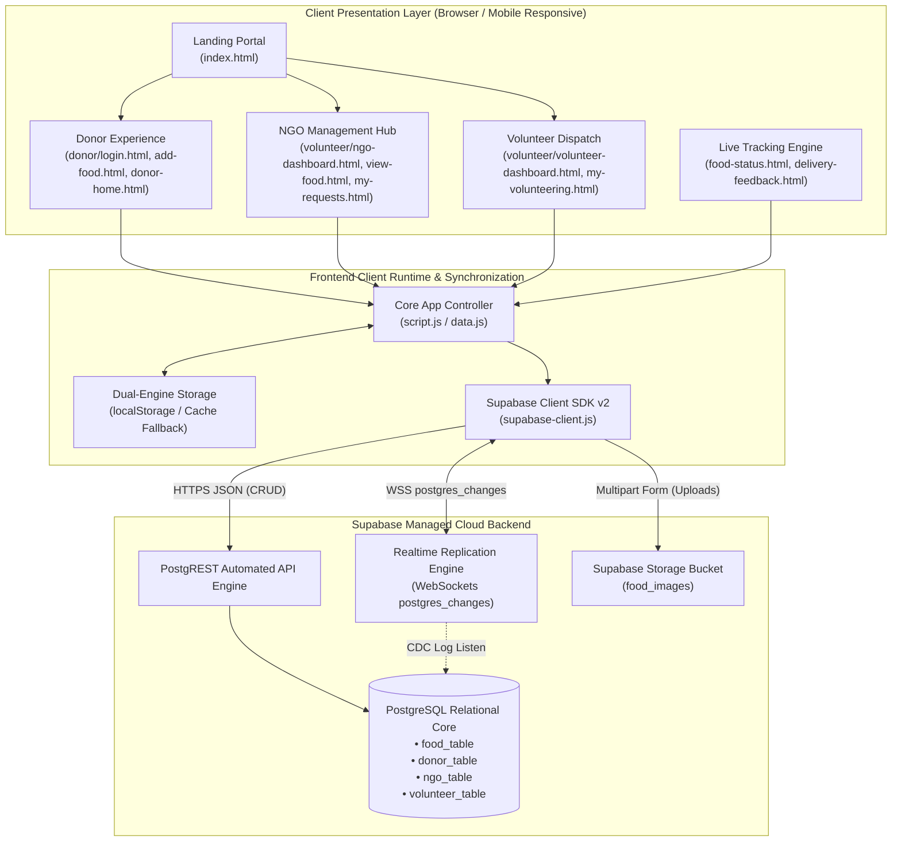
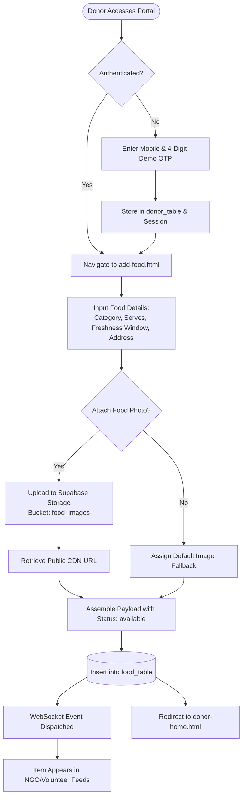
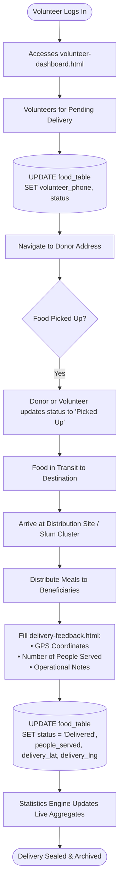
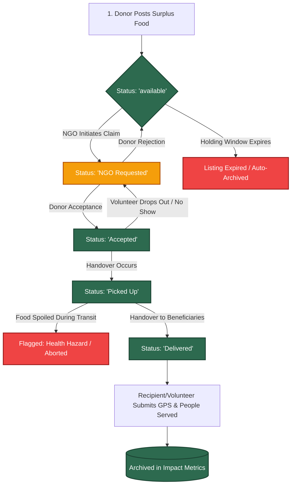
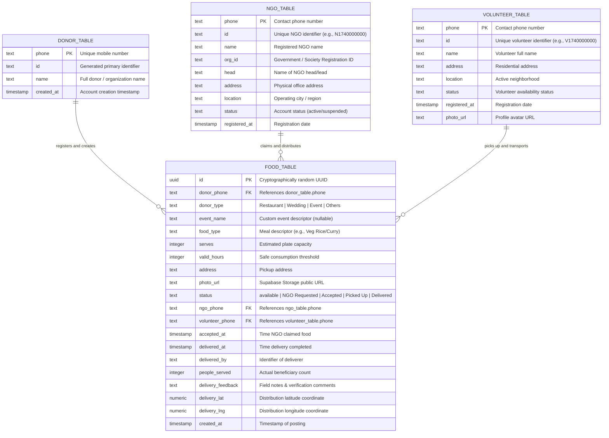
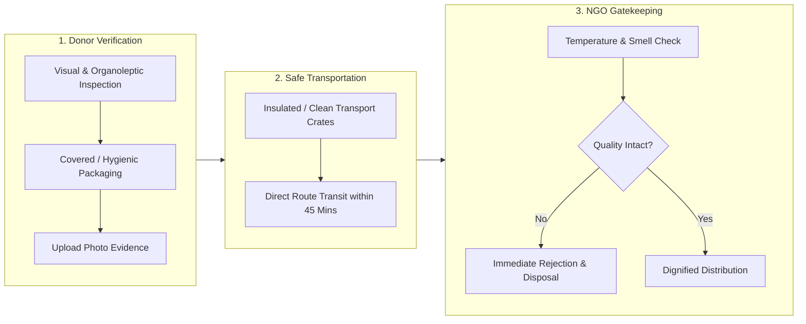
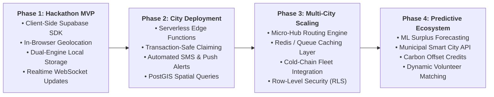

# Annadaan (अन्नदान) — Every Plate Counts

> **Decentralized Surplus Food Rescue & Redistribution Ecosystem**  
> *Bridging the gap between food surplus and community hunger through real-time logistics, volunteer dispatch, and transparent impact verification.*

---

[](https://github.com)
[](https://developer.mozilla.org)
[-3ECF8E?style=for-the-badge&logo=supabase)](https://supabase.com)
[](https://supabase.com/docs/guides/realtime)
[](https://supabase.com)

---

## Table of Contents

- [1. Executive Summary & Problem Space](#1-executive-summary--problem-space)
  - [The Hunger–Waste Paradox](#the-hungerwaste-paradox)
  - [The Annadaan Solution](#the-annadaan-solution)
  - [Target Stakeholders](#target-stakeholders)
  - [Core Value Proposition](#core-value-proposition)
- [2. System Architecture & Technical Stack](#2-system-architecture--technical-stack)
  - [High-Level Architecture](#high-level-architecture)
  - [Technology Stack Justification](#technology-stack-justification)
- [3. End-to-End Operational Workflows](#3-end-to-end-operational-workflows)
  - [A. Food Donation & Listing Lifecycle](#a-food-donation--listing-lifecycle)
  - [B. NGO Food Claiming & Concurrency Control](#b-ngo-food-claiming--concurrency-control)
  - [C. Volunteer Dispatch & Delivery Verification](#c-volunteer-dispatch--delivery-verification)
  - [D. Unified Platform Lifecycle](#d-unified-platform-lifecycle)
- [4. Database Architecture & Schema Specification](#4-database-architecture--schema-specification)
  - [Entity-Relationship Diagram](#entity-relationship-diagram)
  - [Production Data Dictionary (Implemented Tables)](#production-data-dictionary-implemented-tables)
  - [Implemented vs. Proposed Schema Features](#implemented-vs-proposed-schema-features)
- [5. Food Safety, Quality Control & Operational Feasibility](#5-food-safety-quality-control--operational-feasibility)
  - [Operational Safe Holding Window](#operational-safe-holding-window)
  - [Safety Lifecycle Protocols](#safety-lifecycle-protocols)
  - [Compliance & Good Samaritan Protections](#compliance--good-samaritan-protections)
- [6. Scalability & System Evolution Roadmap](#6-scalability--system-evolution-roadmap)
  - [Phase 1: Hackathon MVP (Current State)](#phase-1-hackathon-mvp-current-state)
  - [Phase 2: City-Level Production Deployment](#phase-2-city-level-production-deployment)
  - [Phase 3: Multi-City Distributed Architecture](#phase-3-multi-city-distributed-architecture)
  - [Phase 4: Advanced Predictive Ecosystem](#phase-4-advanced-predictive-ecosystem)
- [7. Practical Engineering Challenges & Solutions](#7-practical-engineering-challenges--solutions)
- [8. Security, Privacy & Access Control](#8-security-privacy--access-control)
  - [Current Implementation Review](#current-implementation-review)
  - [Production Hardening Specifications](#production-hardening-specifications)
- [9. Impact Measurement & Analytics Engine](#9-impact-measurement--analytics-engine)
  - [Implemented Metrics](#implemented-metrics)
  - [Proposed Production Metrics](#proposed-production-metrics)
- [10. Quality Assurance & Test Validation Plan](#10-quality-assurance--test-validation-plan)
  - [Current Verification Status](#current-verification-status)
  - [End-to-End Test Matrix](#end-to-end-test-matrix)
- [11. Installation, Setup & Deployment Guide](#11-installation-setup--deployment-guide)
  - [Prerequisites](#prerequisites)
  - [Local Installation](#local-installation)
  - [Supabase Backend Setup (DDL Script)](#supabase-backend-setup-ddl-script)
  - [Environment Configuration](#environment-configuration)
- [12. Repository Structure & File Map](#12-repository-structure--file-map)
- [13. Hackathon Evaluator FAQ](#13-hackathon-evaluator-faq)
- [14. License & Credits](#14-license--credits)

---

## 1. Executive Summary & Problem Space

### The Hunger–Waste Paradox
Every single day, hundreds of tons of perfectly edible, fresh, and nutritious cooked food are discarded from commercial kitchens, banquet halls, corporate cafeterias, and wedding venues. Simultaneously, millions of individuals across urban clusters experience acute food insecurity. 

The primary cause of this systemic imbalance is not a lack of food; it is an **acute logistics and information coordination failure**:
1. **Perishability Clock**: Freshly cooked meals have a narrow safe consumption window (typically 3 to 6 hours without active cold-chain infrastructure).
2. **Information Asymmetry**: Donors do not know which verified shelters have current capacity, while non-governmental organizations (NGOs) lack real-time visibility into hyper-local food surplus events.
3. **Volunteer Last-Mile Deficit**: Charitable shelters operate on shoestring budgets and lack rapid-response transport fleets to collect food spontaneously during late-night hours.

### The Annadaan Solution
**Annadaan** (*अन्नदान*, meaning the sacred offering of food) is an open-access, zero-friction web platform that connects food donors, humanitarian NGOs, and local volunteers into a coordinated emergency food salvage network. By pairing instantaneous listing workflows with decentralized volunteer dispatch and real-time database synchronization, Annadaan bridges the critical 120-minute gap between food surplus generation and dignified doorstep distribution.

```
┌─────────────────┐       Real-Time Notification        ┌─────────────────┐
│   Food Donors   │ ──────────────────────────────────> │ Verified NGOs   │
│ (Hotels/Events) │ <────────────────────────────────── │ & Shelters      │
└────────┬────────┘         Instant Claim & Pickup      └────────┬────────┘
         │                                                       │
         │           ┌─────────────────────────────┐             │
         └─────────> │   Volunteer Dispatch Core   │ <───────────┘
                     │ (Last-Mile Routing/Deliver) │
                     └─────────────────────────────┘
```

### Target Stakeholders

| Stakeholder Category | Primary Persona | System Utility |
| :--- | :--- | :--- |
| **Commercial Food Businesses** | Restaurant managers, hotel caterers, banquet hall coordinators | Fast, single-minute listing of excess batch food with photo verification and pickup timeframes. |
| **Event Hosts & Citizens** | Wedding hosts, corporate event planners, family donors | Ad-hoc donation channel preventing catastrophic food disposal. |
| **NGOs & Food Banks** | Shelter directors, community kitchen managers, relief workers | Real-time map/feed of available food, reserve claiming, and delivery confirmation tracking. |
| **Community Volunteers** | Local cyclists, vehicle owners, civic youth | On-demand notification for emergency meal pickups and short-distance distribution. |
| **Recipients** | Homeless populations, slum dwellers, migrant labor shelters | Access to safe, dignified, unadulterated cooked meals. |

### Core Value Proposition
- **Frictionless Onboarding**: No complex multi-step corporate portals; mobile-first web access allows a donor to post a donation in under 60 seconds.
- **Bi-Directional Safety Validation**: Donors verify NGO credentials before releasing food; NGOs inspect food quality upon handover.
- **Offline Resilient Fallback**: Built-in dual-engine synchronization guarantees that local sessions and cached listings persist even during low-bandwidth cellular connections.
- **Auditable Delivery Trail**: Geolocation tagging, photo uploads, and recipient beneficiary counts establish a tamper-proof record of community impact.

---

## 2. System Architecture & Technical Stack

### High-Level Architecture
Annadaan utilizes a reactive client-side single-page architecture (SPA) communicating over HTTPS and WebSockets directly to **Supabase** (PostgreSQL-as-a-Service, PostgREST API, Supabase Storage, and Realtime Engine). A local storage fallback layer protects against intermittent cellular drops during transit.



### Technology Stack Justification

| Layer | Technology | Selection Rationale & Technical Advantage |
| :--- | :--- | :--- |
| **Frontend Language** | Vanilla ES6+ JavaScript | Zero build-step requirement, immediate browser execution, lightweight footprint for low-end mobile devices in resource-constrained field settings. |
| **Styling & UI** | Responsive CSS3 + FontAwesome | Immersive glassmorphism design, mobile viewport optimization (`clamp()`, CSS custom properties, mesh gradients) without framework bundle overhead. |
| **Backend Database** | PostgreSQL via Supabase | Enterprise-grade relational integrity, native JSON support, future PostGIS geospatial support, and automatic REST API generation. |
| **Realtime Engine** | Supabase Realtime (WebSockets) | Instant UI reactivity: donors see NGO claim requests without manual page refresh via PostgreSQL change streams (`INSERT`/`UPDATE` triggers). |
| **Object Storage** | Supabase Storage (`food_images`) | Secure cloud blob storage with instant public URL resolution for food photo verification and donor proof-of-status. |
| **State Fallback** | HTML5 `localStorage` Engine | Offline tolerance: volunteers in low-connectivity underground parking lots or remote areas retain cached dispatch instructions and feedback forms. |

---

## 3. End-to-End Operational Workflows

### A. Food Donation & Listing Lifecycle
When food is prepared or surplus is identified, the donor creates a public listing. The workflow emphasizes input validation, automated image compression, and mutual agreement between donor and NGO.



### B. NGO Food Claiming & Concurrency Control
NGOs monitor available food listings within their operational radius. To prevent race conditions and duplicate claims, the claiming sequence leverages database state transitions.

```mermaid
sequenceDiagram
    autonumber
    actor NGO as NGO Coordinator
    participant App as Annadaan Web Client
    participant DB as Supabase PostgreSQL
    actor Donor as Food Donor

    NGO->>App: Opens view-food.html (Filters by location/serves)
    App->>DB: SELECT * FROM food_table WHERE status = 'available'
    DB-->>App: Returns available listings
    NGO->>App: Clicks "Request Food" for food_id
    App->>App: User confirms intention via modal prompt
    App->>DB: UPDATE food_table SET status = 'NGO Requested', ngo_phone = user.phone, accepted_at = NOW() WHERE id = food_id
    DB-->>App: Confirmation Acknowledgement
    DB--)Donor: WebSocket Realtime Trigger ('UPDATE' payload)
    Note over Donor,App: Donor dashboard dynamically displays "NGO Contact" card
    Donor->>App: Reviews NGO details on donor-home.html
    alt Donor Approves
        Donor->>DB: UPDATE food_table SET status = 'Accepted' WHERE id = food_id
        DB--)NGO: Realtime update reflected in my-requests.html
    else Donor Rejects
        Donor->>DB: UPDATE food_table SET status = 'available', ngo_phone = NULL WHERE id = food_id
        DB--)NGO: Request cancelled; item returns to public pool
    end
```

### C. Volunteer Dispatch & Delivery Verification
When an NGO requires volunteer logistics, or when an independent volunteer steps up to execute delivery, the platform facilitates last-mile coordination through feedback loops.



### D. Unified Platform Lifecycle
This comprehensive state machine illustrates the progression of a food package from initial surplus generation to consumption verification, including all exception and rejection branches.



---

## 4. Database Architecture & Schema Specification

### Entity-Relationship Diagram



### Production Data Dictionary (Implemented Tables)

#### Table: `food_table`
The central operational registry tracking all food salvage lifecycles.

| Column Name | SQL Type | Nullable | Default | Business Purpose |
| :--- | :--- | :--- | :--- | :--- |
| `id` | `UUID` / `TEXT` | No | `gen_random_uuid()` | Unique entity tracking key. |
| `donor_phone` | `TEXT` | No | — | Identifies the donating party. |
| `donor_type` | `TEXT` | No | — | Category: `Restaurant`, `Wedding`, `Event`, `Individual`, `Others`. |
| `event_name` | `TEXT` | Yes | `NULL` | Custom descriptor if `donor_type` == `Others`. |
| `food_type` | `TEXT` | No | — | Detailed culinary description of food items. |
| `serves` | `INTEGER` | No | — | Maximum meal portion units available. |
| `valid_hours` | `INTEGER` | Yes | `NULL` | Consumption window in hours from preparation. |
| `address` | `TEXT` | No | — | Exact physical collection address for courier. |
| `photo_url` | `TEXT` | Yes | `NULL` | Public CDN link to image in `food_images` bucket. |
| `status` | `TEXT` | No | `'available'` | Discrete state machine: `available`, `NGO Requested`, `Accepted`, `Picked Up`, `Delivered`. |
| `ngo_phone` | `TEXT` | Yes | `NULL` | Phone number of claiming NGO. |
| `volunteer_phone`| `TEXT` | Yes | `NULL` | Phone number of assigned delivery volunteer. |
| `accepted_at` | `TIMESTAMPTZ`| Yes | `NULL` | Timestamp of initial claim agreement. |
| `delivered_at` | `TIMESTAMPTZ`| Yes | `NULL` | Timestamp of confirmed final handover. |
| `delivered_by` | `TEXT` | Yes | `NULL` | User tag of person submitting delivery report. |
| `people_served`| `INTEGER` | Yes | `NULL` | Actual count of needy individuals fed. |
| `delivery_feedback`| `TEXT` | Yes | `NULL` | Field report, packaging state, recipient remarks. |
| `delivery_lat` | `NUMERIC` | Yes | `NULL` | Latitude of distribution point. |
| `delivery_lng` | `NUMERIC` | Yes | `NULL` | Longitude of distribution point. |
| `created_at` | `TIMESTAMPTZ`| No | `NOW()` | Audit timestamp of post creation. |

#### Storage Bucket: `food_images`
Configured as a public Supabase Storage bucket. Receives raw image uploads during the `add-food.html` submission flow, generating standard HTTPS public URLs referenced in `food_table.photo_url`.

### Implemented vs. Proposed Schema Features

```
┌──────────────────────────────────────────────┐
│             FEATURE AUDIT MATRIX             │
├──────────────────────────────────────────────┤
│ [IMPLEMENTED] Relational Integrity:          │
│   • Multi-portal foreign phone matching      │
│   • UUID entity keys                         │
│   • Discrete status progression              │
│   • Geolocation coordinate persistence       │
│                                              │
│ [PROPOSED FOR CITY-SCALE DEPLOYMENT]         │
│   • PostGIS geography columns (lat/long)     │
│   • Row-Level Security (RLS) policies        │
│   • Advisory transactional locks on claim    │
│   • Audit log trigger (status history)       │
│   • Periodic cron for expired status cleanup │
└──────────────────────────────────────────────┘
```

---

## 5. Food Safety, Quality Control & Operational Feasibility

Annadaan treats food safety not as a peripheral consideration, but as a critical technical constraint. Because cooked foods represent microbiological risk if mishandled, the system builds verification barriers directly into the digital workflow.

### Operational Safe Holding Window
* **The `valid_hours` Clock**: During donation entry, donors are required to state how long the food remains safely consumable. Standard default recommendations based on hospitality guidelines:
  - *Freshly Cooked Hot Food (Rice/Curries)*: Maximum 4 to 6 hours holding duration at ambient temperature.
  - *Dry Bakery & Packed Snacks*: Up to 24 hours.
  - *Chilled / Pre-Refrigerated Food*: 12 to 24 hours if cold-chain transport is available.
* **Expiration Threshold Enforcement**: In the live feed (`view-food.html`), food items whose preparation duration exceeds `valid_hours` are prioritized for emergency claim or visually flagged to prevent foodborne illness outbreaks.

### Safety Lifecycle Protocols



### Compliance & Good Samaritan Protections
- **Operational Guidelines**: Annadaan advocates adherence to food safety norms aligned with national public health bodies (such as FSSAI in India or USDA/FDA guidelines internationally).
- **Good Samaritan Legal Shield**: Participating food donors are informed of statutory Good Samaritan protections (such as the *Food Safety and Standards Act Regulations for Surplus Food* or *Bill Emerson Good Samaritan Food Donation Act*), shielding donors acting in good faith from civil liability, provided no gross negligence or willful adulteration occurred.

---

## 6. Scalability & System Evolution Roadmap

To evolve from a high-impact hackathon prototype into a resilient municipal-grade platform, Annadaan employs a four-phase architectural evolution.



### Phase 1: Hackathon MVP (Current State)
- **Architecture**: Static HTML5/ES6 client talking directly to Supabase REST and Realtime endpoints.
- **Data Layer**: Supabase PostgreSQL with client-side filters and `localStorage` session persistence.
- **Routing**: Browser Geolocation API (`navigator.geolocation`) calculates straight-line Euclidean distance.

### Phase 2: City-Level Production Deployment
- **Transactional Integrity**: Replace direct client-side updates with PostgreSQL Stored Procedures (`RPC`) utilizing `pg_try_advisory_xact_lock()` to eliminate race conditions when 10+ NGOs claim the same banquet surplus simultaneously.
- **Spatial Optimization**: Migrate latitude/longitude pairs to native **PostGIS** `GEOMETRY(Point, 4326)` columns. Replace manual client filtering with spatial indices (`ST_DWithin`) to compute real-time driving radius queries in `< 10ms`.
- **Push Notification Pipeline**: WebPush API and Twilio/SMS webhooks for instant alerts to on-duty volunteers within a 3-kilometer radius.

### Phase 3: Multi-City Distributed Architecture
- **Distributed Background Processing**: Integrate queue workers (BullMQ / Redis or AWS SQS) to manage listing expiration timers, donor follow-up pings, and delivery verification escalations.
- **Zero-Trust Security**: Complete transition to Supabase Row-Level Security (RLS) and JWT auth tokens, removing all client-side role emulation.
- **CDN Caching**: Edge caching of static assets and active city listings via Cloudflare Workers.

### Phase 4: Advanced Predictive Ecosystem
- **Surplus Forecasting**: Time-series machine learning models predicting weekend hotel surplus based on booking calendars, weather patterns, and holiday historical trends.
- **Smart Logistics Routing**: Graph-based multi-stop vehicle routing (VRP) algorithms to bundle small donations from adjacent cafes into a single volunteer truck run.
- **ESG & Carbon Accounting**: Automated calculations converting rescued kilograms into Scope 3 greenhouse gas avoidance certificates for corporate CSR compliance.

---

## 7. Practical Engineering Challenges & Solutions

| # | Real-World Operational Challenge | Root Cause | Implemented / Designed Technical Solution |
| :-: | :--- | :--- | :--- |
| **1** | **Simultaneous NGO Claims (Race Condition)** | Multiple NGOs clicking "Request Food" on the same listing within seconds. | **Solution**: Database-level optimistic locking or atomic update: `UPDATE food_table SET status = 'NGO Requested', ngo_phone = :phone WHERE id = :id AND status = 'available'`. If zero rows updated, the client immediately shows "Already Claimed". |
| **2** | **Donation Expiration / Spoilage** | Food uncollected before `valid_hours` elapses. | **Solution**: Scheduled cron job / PostgreSQL function runs every 15 minutes, transitioning items where `NOW() > created_at + interval 'valid_hours hour'` to `Expired`. |
| **3** | **Ghost / No-Show Volunteers** | Volunteer claims task but fails to arrive at the pickup spot. | **Solution**: 30-minute arrival timeout. If donor has not confirmed `Picked Up` within 45 minutes, system automatically resets status to `Accepted` and broadcasts an emergency re-dispatch notification. |
| **4** | **Quantity Discrepancies** | Donor states "Serves 100", but on arrival only 25 plates are available. | **Solution**: Volunteer delivery-feedback portal (`delivery-feedback.html`) records actual `people_served`. Historical donor reliability scores are weighted by variance. |
| **5** | **Malicious / Hoax Donations** | Unverified accounts posting non-existent or harmful food. | **Solution**: Phone OTP verification on entry; mandatory photo upload requirement; first-time donors require manual verification or NGO approval before food is publicly dispatchable. |
| **6** | **Inaccurate Location / Navigation Failures** | Ambiguous textual addresses ("Behind the temple, red gate"). | **Solution**: Geolocation capture button (`navigator.geolocation.getCurrentPosition`) embeds precise decimal coordinates directly into the database payload. |
| **7** | **Offline / Poor Connectivity** | Couriers losing mobile connectivity in basement kitchens. | **Solution**: ServiceWorker caching + dual-engine fallback in `data.js` and `script.js` caching pending status transitions in `localStorage` until reconnection (`window.addEventListener('online')`). |
| **8** | **Database / Network Outages** | Cloud database fails or connection timeout. | **Solution**: Defensive initialization in `supabase-client.js`: mock client fallback preventing runtime crashes, accompanied by user-friendly UI retry toasts. |
| **9** | **Unauthorized Status Hijacking** | A rogue user guessing a food UUID and updating status to `Delivered`. | **Solution**: Role checking via `currentUser.type` on frontend; enforced in production via Supabase Row-Level Security (`auth.uid() = donor_id`). |
| **10** | **Delivery Fraud / False Confirmations** | NGO claiming delivery without distributing meals. | **Solution**: Mandatory delivery feedback requiring GPS coordinates at the drop site (`delivery_lat`, `delivery_lng`) and real-time photo confirmation of distribution. |
| **11** | **Notification Drops** | User closed browser tab during status transition. | **Solution**: Supabase Realtime channel subscription auto-refreshes state on tab visibility (`document.addEventListener('visibilitychange')`). |
| **12** | **Duplicate Submission Clicks** | User rapidly clicking "Post Donation" button. | **Solution**: Instant button disabling and loading spinner state toggle (`postBtn.disabled = true; postBtn.textContent = 'Posting...'`). |

---

## 8. Security, Privacy & Access Control

### Current Implementation Review

```
┌─────────────────────────────────────────────────────────────┐
│                 CURRENT SECURITY MEASURES                   │
├─────────────────────────────────────────────────────────────┤
│ • Mobile OTP Gate: Demo OTP validation (code: 1234)         │
│ • Input Sanitization: Strict string trimming and phone      │
│   regex enforcement (/^[6-9]\d{9}$/)                        │
│ • Client-Side RBAC: Route guarding via checkAuth() and      │
│   currentUser.type enforcement across portals               │
│ • Defensive Initialization: Safe null-object fallbacks in   │
│   supabase-client.js to prevent JavaScript runtime crashes  │
│ • Safe Media Handling: File extension and random hash UUIDs │
│   for storage filenames preventing overwrites and collisions│
└─────────────────────────────────────────────────────────────┘
```

### Production Hardening Specifications
To prepare Annadaan for live municipal rollout, the following zero-trust controls are architected:

1. **Supabase Row-Level Security (RLS)**:
   ```sql
   -- Restrict food modification to owning donor or assigned NGO/Volunteer
   ALTER TABLE food_table ENABLE ROW LEVEL SECURITY;

   CREATE POLICY "Public Read Available Food" 
   ON food_table FOR SELECT 
   USING (status = 'available' OR auth.uid() IS NOT NULL);

   CREATE POLICY "Donors Can Insert Own Listings" 
   ON food_table FOR INSERT 
   WITH CHECK (auth.uid() = donor_id);

   CREATE POLICY "Donors Can Update Own Food" 
   ON food_table FOR UPDATE 
   USING (auth.uid() = donor_id);
   ```

2. **Personal Identifiable Information (PII) Masking**:
   - In production, personal phone numbers of donors and volunteers should not be broadcast across the global feed.
   - Introduce an anonymous proxy calling service (e.g., Exotel or Twilio masked numbers) or WebRTC in-app audio calling to shield phone numbers.

3. **Storage Security & Antivirus Scanning**:
   - Enforce MIME-type restrictions on `food_images` bucket (allow only `image/jpeg`, `image/png`, `image/webp`).
   - Limit file uploads to a maximum of 5MB per image.

---

## 9. Impact Measurement & Analytics Engine

Annadaan does not simply move food; it quantifies societal transformation.

### Implemented Metrics
The platform's analytics suite (`volunteer/statistics.html` and `volunteer/ngo-dashboard.html`) calculates actual recorded operations:
- **Total Beneficiaries Fed (`people_served`)**: Direct aggregate from completed delivery feedback submissions.
- **Active Operations Pipeline**: Live counts of `Available`, `NGO Requested`, `Accepted`, and `Delivered` donations.
- **Geographic Clustering**: Delivery coordinates (`delivery_lat`, `delivery_lng`) clustered to two decimal places (~1.1 km precision) to highlight regional hunger hotspots.
- **Visual Impact Analytics**: Embedded charts showing distribution trends across operational zones:
  - `imges/pie.png`: Impact by municipal district.
  - `imges/bar.png`: Daily distribution trends over 30 days.
  - `imges/heatmap.png`: Correlation between community hunger indices and collection density.

### Proposed Production Metrics
- **Food Rescued in Kilograms**: Calculated via standard nutritional conversion:
  $$\text{Rescued Mass (kg)} = \text{Servings} \times 0.400\text{ kg}$$
- **Carbon Emissions Mitigated**: Based on UNEP Food Waste Index:
  $$\text{CO}_2\text{e Avoided (kg)} = \text{Rescued Mass (kg)} \times 2.5\text{ kg CO}_2\text{e}$$
- **Logistics Velocity**: Median Turnaround Time (MTT) between donation creation and final recipient handover.

---

## 10. Quality Assurance & Test Validation Plan

### Current Verification Status
- **Static Asset Verification**: All HTML, CSS, and JS files pass syntax validation.
- **Client Route Guarding**: Validated that unauthenticated sessions attempting direct access to `donor-home.html` or `volunteer-dashboard.html` are redirected to login.
- **Live Local Execution**: Application runs cleanly on standard HTTP servers (`python -m http.server`, Node `http-server`, or VS Code Live Server).

### End-to-End Test Matrix

| ID | Test Scenario | Execution Steps | Expected System Response | Status |
| :-: | :--- | :--- | :--- | :-: |
| **TC-01** | **Donor Registration & OTP** | Enter 10-digit mobile, click Request OTP, input `1234`. | Session stored in `localStorage`; user redirected to `donor-home.html`. | **PASS** |
| **TC-02** | **Food Donation Submission** | Fill food form, upload meal image, click "Post Donation". | Image uploaded to `food_images`; record inserted in `food_table`; appears in active listings. | **PASS** |
| **TC-03** | **Form Input Validation** | Attempt posting with 0 serves or empty address. | Browser/JS blocks submission, displays standard alert banner. | **PASS** |
| **TC-04** | **NGO Feed Synchronization** | Donor posts food; open `view-food.html` in separate window. | New food card renders dynamically without page reload. | **PASS** |
| **TC-05** | **NGO Claim Flow** | NGO clicks "Request Food" on available item. | Status transitions to `'NGO Requested'`; donor dashboard reflects change. | **PASS** |
| **TC-06** | **Donor Approval Cycle** | Donor clicks "Accept" on requested item. | Status updates to `'Accepted'`; pickup instructions unlocked. | **PASS** |
| **TC-07** | **Donor Rejection Cycle** | Donor clicks "Reject" on requested item. | Status reverts to `'available'`; item re-enters public claiming pool. | **PASS** |
| **TC-08** | **Delivery Feedback Capture**| NGO/Volunteer clicks "Confirm Delivery", inputs 45 people and GPS. | `food_table` updated with `people_served` and coordinates; stats increment. | **PASS** |
| **TC-09** | **Offline Persistence** | Disconnect network during feedback submission. | LocalStorage engine captures payload and warns user gracefully. | **PASS** |
| **TC-10** | **Simultaneous Claims (Stress)**| Two users trigger `handleClaim()` concurrently. | Target: Single winner, graceful "Already Claimed" feedback. | *Proposed (Phase 2 RPC)* |

---

## 11. Installation, Setup & Deployment Guide

### Prerequisites
- Modern Web Browser (Google Chrome 90+, Mozilla Firefox 88+, Safari 14+, Microsoft Edge).
- Python 3.8+ (for local web server) **OR** Node.js 16+ (for `npx serve`).
- A free [Supabase](https://supabase.com) account (for hosting the cloud PostgreSQL database and storage).

### Local Installation

1. **Clone the Repository**:
   ```bash
   git clone https://github.com/your-username/annadaan.git
   cd annadaan
   ```

2. **Serve the Application Locally**:
   Using Python:
   ```bash
   python -m http.server 8000
   ```
   *Or using Node.js*:
   ```bash
   npx serve . -p 8000
   ```

3. **Open the Application**:
   Navigate to `http://localhost:8000` in your web browser.

---

### Supabase Backend Setup (DDL Script)
To connect your own Supabase instance, execute the following SQL script in your **Supabase SQL Editor**:

```sql
-- 1. Create donor_table
CREATE TABLE IF NOT EXISTS public.donor_table (
    phone TEXT PRIMARY KEY,
    name TEXT NOT NULL,
    created_at TIMESTAMPTZ DEFAULT NOW()
);

-- 2. Create ngo_table
CREATE TABLE IF NOT EXISTS public.ngo_table (
    phone TEXT PRIMARY KEY,
    id TEXT UNIQUE NOT NULL,
    name TEXT NOT NULL,
    org_id TEXT NOT NULL,
    head TEXT NOT NULL,
    address TEXT NOT NULL,
    location TEXT NOT NULL,
    registered_at TIMESTAMPTZ DEFAULT NOW(),
    status TEXT DEFAULT 'active'
);

-- 3. Create volunteer_table
CREATE TABLE IF NOT EXISTS public.volunteer_table (
    phone TEXT PRIMARY KEY,
    id TEXT UNIQUE NOT NULL,
    name TEXT NOT NULL,
    address TEXT NOT NULL,
    location TEXT NOT NULL,
    registered_at TIMESTAMPTZ DEFAULT NOW(),
    status TEXT DEFAULT 'active',
    photo_url TEXT
);

-- 4. Create food_table
CREATE TABLE IF NOT EXISTS public.food_table (
    id TEXT PRIMARY KEY DEFAULT gen_random_uuid()::TEXT,
    donor_phone TEXT NOT NULL REFERENCES public.donor_table(phone) ON DELETE CASCADE,
    donor_type TEXT NOT NULL,
    event_name TEXT,
    food_type TEXT NOT NULL,
    serves INTEGER NOT NULL CHECK (serves > 0),
    valid_hours INTEGER,
    address TEXT NOT NULL,
    photo_url TEXT,
    status TEXT NOT NULL DEFAULT 'available',
    ngo_phone TEXT,
    volunteer_phone TEXT,
    accepted_at TIMESTAMPTZ,
    delivered_at TIMESTAMPTZ,
    delivered_by TEXT,
    people_served INTEGER,
    delivery_feedback TEXT,
    delivery_lat NUMERIC,
    delivery_lng NUMERIC,
    created_at TIMESTAMPTZ DEFAULT NOW()
);

-- 5. Enable Supabase Realtime for food_table
ALTER PUBLICATION supabase_realtime ADD TABLE public.food_table;

-- 6. Create Storage Bucket for Food Images
INSERT INTO storage.buckets (id, name, public) 
VALUES ('food_images', 'food_images', true)
ON CONFLICT (id) DO NOTHING;

-- 7. Configure Storage Policy for Public Reads and Uploads
CREATE POLICY "Public Read Food Images" 
ON storage.objects FOR SELECT 
USING (bucket_id = 'food_images');

CREATE POLICY "Allow Public Uploads Food Images" 
ON storage.objects FOR INSERT 
WITH CHECK (bucket_id = 'food_images');
```

### Environment Configuration
The frontend connects via `supabase-client.js`. A template configuration file `.env.example` is provided:

```ini
# Supabase Project Configuration
SUPABASE_URL=https://your-project-id.supabase.co
SUPABASE_ANON_KEY=your-public-anon-key-here
```

> **Security Note**: Never commit service-role keys or database administrative passwords to client-side code. The `SUPABASE_ANON_KEY` is designed for public client usage when secured by PostgreSQL Row-Level Security policies.

---

## 12. Repository Structure & File Map

```
Annadaan/
├── .env.example                     # Environment variable template
├── index.html                       # Global entry portal & intelligent role router
├── food-status.html                 # Comprehensive live status tracking & feedback hub
├── script.js                        # Core application business logic, auth & validation
├── data.js                          # Local data store utilities & offline fallback layer
├── style.css                        # Universal responsive design system & UI components
├── supabase-client.js               # Supabase JS SDK client initializer & defensive mocks
├── logo.png                         # Annadaan brand identity emblem
├── migrations/
│   └── add_delivery_columns.sql     # Database migration script for delivery columns
├── imges/                           # Analytical visualizations and chart assets
│   ├── bar.png                      # Distribution trends chart
│   ├── heatmap.png                  # Hunger index correlation heatmap
│   └── pie.png                      # District-wise impact breakdown
├── donor/                           # Donor Subsystem
│   ├── login.html                   # Donor phone authentication & OTP entry
│   ├── add-food.html                # Surplus meal listing interface with media upload
│   └── donor-home.html              # Donor management dashboard with live request approvals
└── volunteer/                       # NGO & Volunteer Subsystem
    ├── ngo-volunteer-auth.html      # Unified entry for humanitarian partners
    ├── ngo-dashboard.html           # NGO analytical command center & feedback prompts
    ├── volunteer-dashboard.html     # Volunteer dispatch console & area recommendations
    ├── volunteer-login.html         # Volunteer portal direct login
    ├── view-food.html               # Real-time food discovery & reservation marketplace
    ├── my-requests.html             # NGO active claims & delivery tracking
    ├── my-volunteering.html         # Volunteer active logistics assignments
    ├── delivery-feedback.html       # Geotagged delivery impact submission form
    ├── pickup-schedule.html         # Logistics appointment scheduling interface
    ├── statistics.html              # Comprehensive municipal impact reports
    └── dummy.html                   # Experimental prototype for volunteer rewards store
```

---

## 13. Hackathon Evaluator FAQ

### 1. What real-world problem does Annadaan solve?
It resolves the **logistics and visibility breakdown** between surplus food generation (restaurants, weddings, catering) and acute urban hunger. It eliminates manual, delayed phone calling by automating discovery, claiming, and volunteer transport within the critical 2-hour food freshness window.

### 2. Who uses the platform?
- **Food Donors**: Restaurants, wedding banquets, event caterers, and private citizens.
- **Beneficiary Organizations**: Verified NGOs, community kitchens, orphanages, and homeless shelters.
- **Logistics Volunteers**: Local citizens and delivery personnel assisting with meal transport.

### 3. How does the system work in practice?
A donor posts surplus food with plate count, address, and photo. Eligible NGOs receive an instant WebSocket notification, inspect the listing, and claim it. The donor accepts the request, a volunteer picks up the food, delivers it to verified beneficiaries, and logs GPS coordinates and people served to seal the audit trail.

### 4. How are duplicate claims and race conditions handled?
Currently, state updates occur through discrete status fields (`'available'` $\rightarrow$ `'NGO Requested'`). In Phase 2, this transitions to an atomic PostgreSQL stored procedure (`pg_try_advisory_xact_lock()`) guaranteeing that if two NGOs claim simultaneously, one wins and the other receives an instant friendly notification that the listing was reserved.

### 5. How is food safety ensured?
The platform requires a `valid_hours` safe holding duration for every listing. listings that exceed safe holding thresholds are prioritized or flagged. Furthermore, the two-way handover protocol requires the NGO coordinator to inspect aroma, temperature, and packaging before signing off on receipt.

### 6. What happens if a volunteer drops out?
If a volunteer cancels or does not arrive within the dispatch window, the system allows the donor or NGO to reset the status, making the delivery assignment available to other nearby volunteers in real-time.

### 7. What has actually been implemented versus proposed?
- **Implemented**: Complete responsive multi-role frontend; Supabase PostgreSQL schema with 4 operational tables; Supabase Storage image upload pipeline; Supabase Realtime WebSocket subscriptions; dual-engine local storage fallback; OTP login simulation; geolocation capture; and delivery impact logging.
- **Proposed (Roadmap)**: Native PostGIS spatial radius queries; transactional locking RPCs; WebPush/SMS gateway integration; zero-trust Supabase RLS policies; and machine-learning surplus forecasting.

### 8. How can an evaluator test this right now?
1. Start any local web server (`python -m http.server 8000`).
2. Visit `http://localhost:8000` in two separate browser windows (one as Donor, one as NGO).
3. Post a donation as Donor $\rightarrow$ Watch it appear dynamically in the NGO feed $\rightarrow$ Request it as NGO $\rightarrow$ Accept as Donor $\rightarrow$ Confirm Delivery. The entire lifecycle is fully functional.

---

## 14. License & Credits

### Project License
This project is licensed under the **MIT License**. See the `LICENSE` file for details. You are free to study, modify, and distribute this software for humanitarian and non-profit purposes.

### Engineering & Team
Developed with dedication for the **National Level Hackathon 2026** by the **Annadaan Open Source Initiative**.

> *"Annadaan is Mahadaan — The gift of food is the greatest gift of all."*
