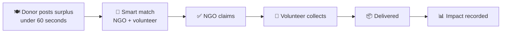
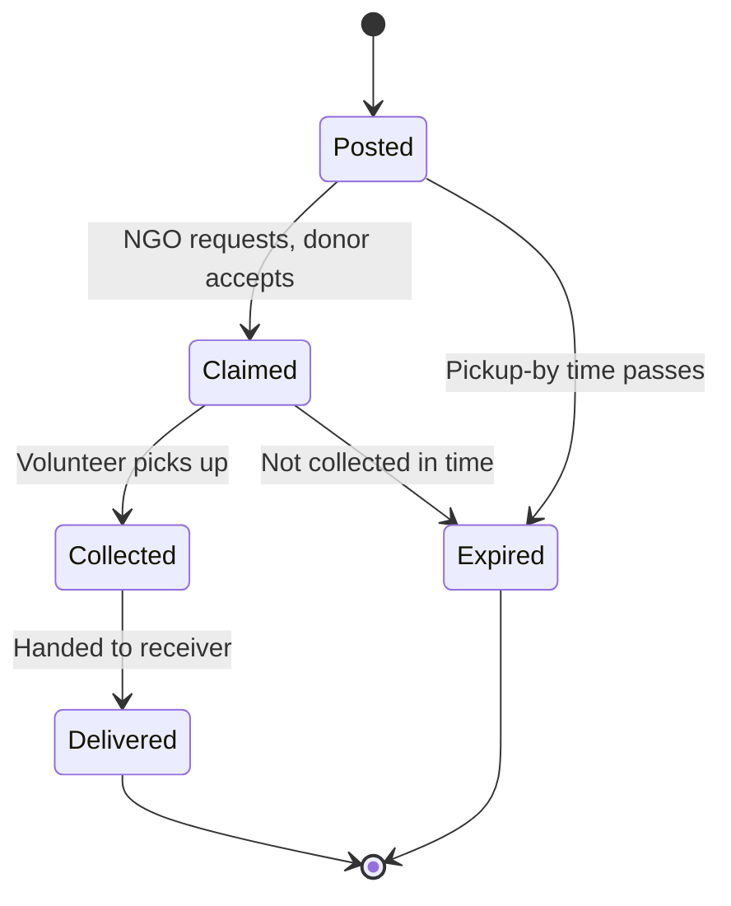
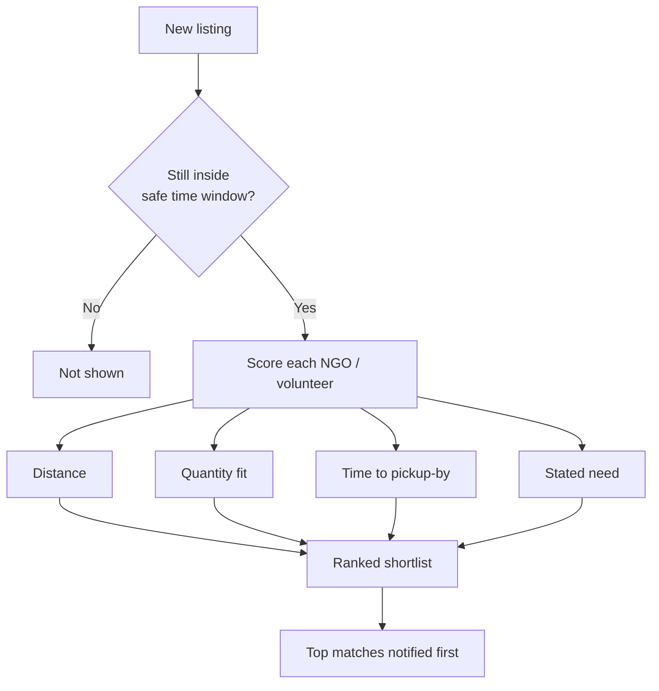
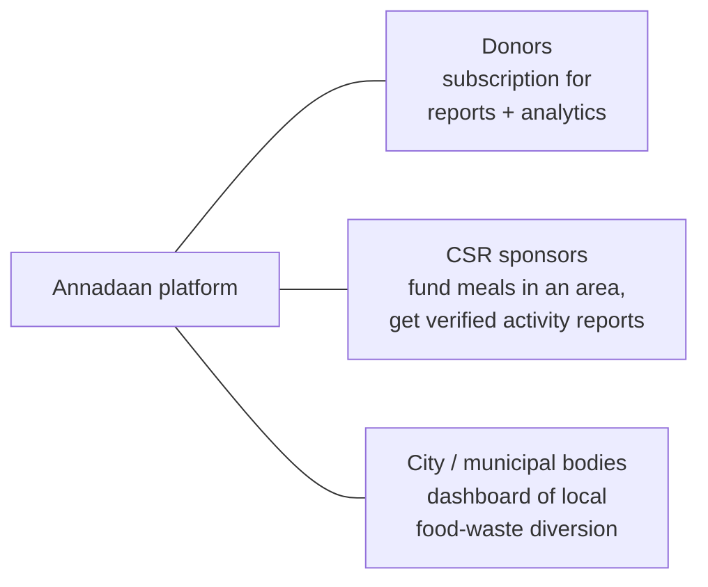
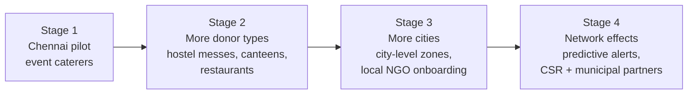
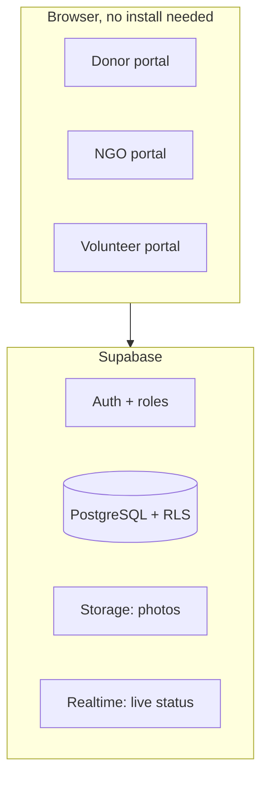

# 🍛 Annadaan: Every Plate Counts

**Surplus food, matched to the people who need it, before it spoils.**

> Built for **Codebenders ACE Builders Hackathon 2026**, **Problem Statement 2: Rescue the Surplus** (Society & Environment)

🌐 **Live project:** https://annadaan.vinaysuhirthan.tech
👤 **Built by:** Vinay Suhirthan · ksvinaysuhirthan@gmail.com

---

## The problem, in one breath

Caterers, wedding halls, restaurants and hostel messes throw away edible food every single day. A few kilometres away, shelters and community kitchens are short of meals. Nobody is ignoring anyone. There's just no fast, reliable way to connect the two **before the food goes bad**.

Annadaan is that connection: **post it, match it, collect it, prove it.**

---

## How it works



Every listing moves through four live statuses:



Expiry is a first-class state. If food isn't collected inside its window, it's pulled from the board instead of sitting there looking available.

---

## What we built (mapped to the problem statement)

| Problem Statement requirement | How Annadaan answers it |
|---|---|
| **Donor flow under a minute:** what, how much, pickup-by | One short form: food type, quantity, pickup-by time, photo. Nothing else is mandatory. |
| **Smart matching** by distance, quantity, timing, need | Listings are ranked for receivers using a weighted score (see below). |
| **Live pickup coordination:** posted → claimed → collected → delivered | Status tracking on Supabase Realtime, visible to donor, NGO and volunteer. |
| **Impact view** with assumptions shown | Meals saved and waste avoided, with the formula and assumptions displayed next to every number. |
| **Handling & safety info** per listing | Time window, storage guidance and allergen fields on every listing. |
| **Business case** for donors and sponsors | See [Who pays](#who-pays-and-why-a-busy-caterer-keeps-using-it). |
| **Guardrails** | See [Guardrails we respect](#guardrails-we-respect). |

### How matching works



The idea is deliberately simple: nearer, better-sized, more urgent and more needed ranks higher. A transparent score is easier to trust, test and tune than a black box.

---

## Starting focused: one city, one donor type

The brief says to pick one and start there. So:

- **City:** Chennai
- **First donor type:** event caterers and wedding halls (large, predictable surplus, often at fixed times of day)
- **First receivers:** registered NGOs, community kitchens and shelters within a short radius

Why this wedge? Surplus from events is **bulk, scheduled and known in advance**, which is exactly where a coordination tool beats ad-hoc phone calls.

---

## Who pays, and why a busy caterer keeps using it

A caterer won't use a platform out of guilt for more than a week. They'll use it if it's **faster than the alternative and gives them something back.**

| What the donor gets | Why it matters weekly |
|---|---|
| Posting in under a minute | Cheaper than phoning around after a 10 pm event |
| Less waste to dispose of | Lower disposal hassle and cost |
| A shareable impact report | Proof of responsible practice for clients and brand |

**Revenue model (hypothesis to validate with pilots):**



- **Free for NGOs and volunteers.** The supply side must never be gated.
- **Donors:** a free tier for posting; paid tier for impact reports, recurring-donor tools and multi-outlet management.
- **CSR sponsors:** sponsor a zone or a number of meals and receive activity reports with the assumptions visible.
- **City authorities:** aggregated, anonymised waste-diversion data by area.

---

## Impact, with the assumptions shown

We never show a bare number. Every figure comes with how it was calculated.

| Metric | Formula | Default assumption (editable) |
|---|---|---|
| **Meals saved** | delivered food (kg) ÷ kg per meal | ~0.4 kg per meal |
| **Food waste avoided** | delivered food (kg) | counts only listings marked *Delivered* |
| **CO₂e avoided** | food waste avoided × emission factor | ~2.5 kg CO₂e per kg of food waste (landfill estimate) |

> ⚠️ These are **estimates**, not audited figures. Values in demos are **sample data** and are labelled as such.

---

## Scalability: built to grow past one city

This is where most hackathon projects stop. We designed for what comes next.



**Why the architecture scales:**

- **Managed backend.** Supabase (PostgreSQL, Auth, Storage, Realtime) handles growth without us running servers.
- **Zone-based design.** Each city or neighbourhood is a zone, so adding one means adding data, not rewriting code.
- **Stateless frontend.** Static HTML/CSS/JS can be served from any CDN, so traffic is cheap to absorb.
- **Role-based access.** Donor, NGO and volunteer permissions are enforced at the database layer with row-level security.
- **Safe claiming.** Donations are claimed with a single atomic update, so two NGOs can't both win the same listing.



---

## Practicality and feasibility

- **No app download.** Works in any modern browser, including on a low-end phone.
- **Zero special hardware.** No sensors, no fleet, no dedicated drivers. We coordinate people who already exist (volunteers, NGO staff).
- **Low operating cost.** Managed services mean the pilot runs on a small cloud budget.
- **Built around real timing.** Pickup-by times and expiry are core to the data model, not an afterthought.
- **Roles match reality.** Donors, NGOs and volunteers each see only what they need to act.

---

## Guardrails we respect

- **Annadaan connects people. It does not certify that food is safe.** Safety is the responsibility of the donor and the receiving organisation.
- Every listing shows **time window, storage and allergen** guidance.
- A photo upload is **not** an AI food-safety check.
- We **do not promise tax or legal benefits** to donors. Impact reports are records of activity only.
- The demo uses **sample / synthetic data only.** No real addresses or personal details are published.
- **Secrets stay out of the frontend.** Only the public Supabase client key is used in the browser. Tables and storage are protected by Supabase policies.

---

## Tech stack

| Layer | Choice |
|---|---|
| Frontend | HTML, CSS, JavaScript |
| Database & Auth | Supabase (PostgreSQL, Auth) |
| File storage | Supabase Storage (food photos) |
| Live updates | Supabase Realtime |
| Browser APIs | Geolocation (when the user allows it) |

---

## Run it locally

You'll need a modern browser, plus Python or Node.js.

```bash
git clone <your-repository-url>
cd Annadaan
```

1. Add your Supabase project URL and **public (anon) key** in `supabase-client.js`.
2. Start a local server:

```bash
python -m http.server 8000
# or
npx serve . -p 8000
```

3. Open `http://localhost:8000`.

> 🔒 Never put a service-role key or database password in frontend code, and never commit secrets.

## Project structure

```text
Annadaan/
├── donor/              # Donor pages
├── volunteer/          # NGO and volunteer pages
├── migrations/         # Database migrations
├── images/             # Image assets
├── index.html          # Entry page
├── script.js           # Application logic
├── data.js             # Data helpers
├── style.css           # Shared styles
└── supabase-client.js  # Supabase connection
```

---

## Honest status

Annadaan is a **hackathon prototype**. It proves the full loop (post → match → claim → collect → deliver → record) but is not yet an audited production service.

**Next up:**

- [ ] Pilot with a small set of Chennai caterers and NGOs
- [ ] Stronger role-based database policies and session handling
- [ ] Concurrency-safe claiming under simultaneous requests
- [ ] Better mobile experience across all three portals
- [ ] Automated tests for workflows, data integrity and security
- [ ] Reminders and alerts as pickup-by times approach

---

## Author

**Vinay Suhirthan**
📧 ksvinaysuhirthan@gmail.com
🌐 https://annadaan.vinaysuhirthan.tech

*Codebenders ACE Builders Hackathon 2026 · Problem Statement 2: Rescue the Surplus*

**Annadaan. A meal shared can make a difference.**
